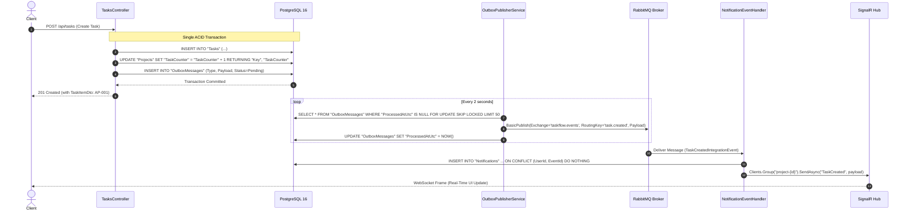
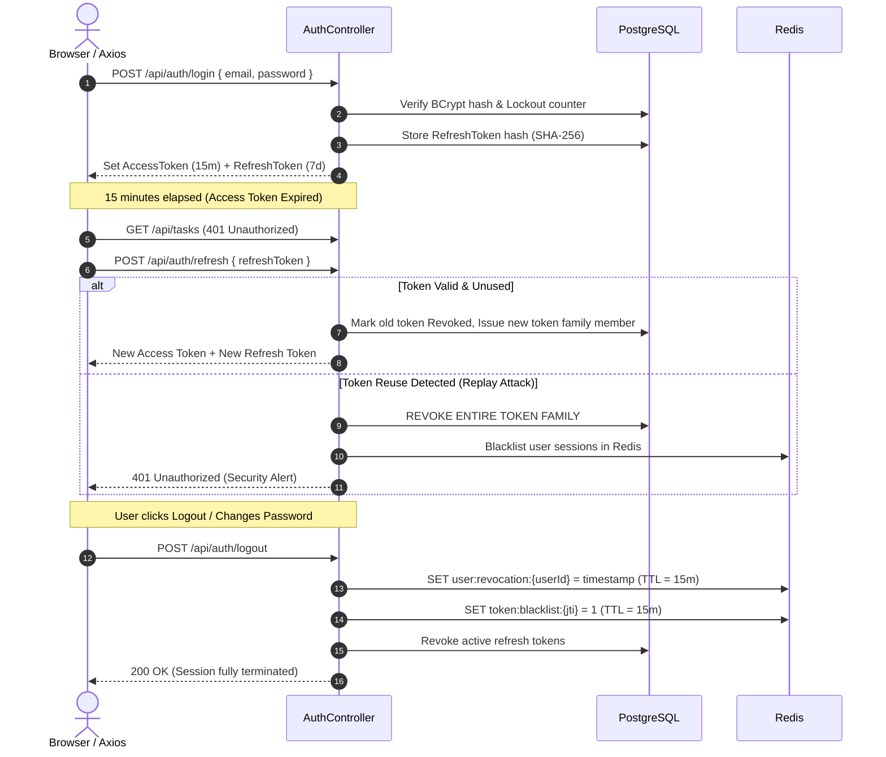

# TaskFlow

> **Live demo:** [taskflow.cloudafk.xyz](https://taskflow.cloudafk.xyz) · [API health](https://api-taskflow.cloudafk.xyz/health)

[]()
[]()
[]()
[]()
[]()
[]()
[]()
[](LICENSE)

**TaskFlow** is a full-stack project and task management application built with **ASP.NET Core 10**, **Next.js 16**, and **PostgreSQL**. It includes project workspaces, task boards, role-based access control, authentication, notifications, and real-time collaboration over SignalR. The application is organized into Domain, Application, Infrastructure, API, and frontend layers, and can be run locally or deployed with Docker Compose.

> **Demo access:** Administrator credentials are not published in this repository. Do not reuse or expose production administrator accounts for public demonstrations.

---

## Table of Contents

- [Architectural Overview](#architectural-overview)
  - [High-Level System Topology](#high-level-system-topology)
  - [Clean Architecture & Layer Separation](#clean-architecture--layer-separation)
  - [Transactional Outbox & Event-Driven Relay](#transactional-outbox--event-driven-relay)
  - [JWT Token Rotation & Session Revocation](#jwt-token-rotation--session-revocation)
  - [Real-Time SignalR Collaboration](#real-time-signalr-collaboration)
- [Enterprise Features & Engineering Deep Dive](#enterprise-features--engineering-deep-dive)
  - [1. Authentication, Lockout & Token Security](#1-authentication-lockout--token-security)
  - [2. Multi-Tenant Role-Based Access Control (RBAC)](#2-multi-tenant-role-based-access-control-rbac)
  - [3. Atomic Task Identifiers & Optimistic Concurrency](#3-atomic-task-identifiers--optimistic-concurrency)
  - [4. Distributed Caching & Invalidation Strategy](#4-distributed-caching--invalidation-strategy)
  - [5. Resilient Messaging Topology (RabbitMQ + DLX)](#5-resilient-messaging-topology-rabbitmq--dlx)
  - [6. Real-Time WebSocket Synchronization](#6-real-time-websocket-synchronization)
- [Technology Stack](#technology-stack)
- [Repository Structure](#repository-structure)
- [Environment Configuration](#environment-configuration)
- [Getting Started](#getting-started)
  - [Option A: Docker Compose (Recommended)](#option-a-docker-compose-recommended)
  - [Option B: Local Host Development](#option-b-local-host-development)
- [Automated Testing & Quality Gates](#automated-testing--quality-gates)
- [REST API Reference & Examples](#rest-api-reference--examples)
  - [Authentication API (`/api/auth`)](#authentication-api-apiauth)
  - [Projects API (`/api/projects`)](#projects-api-apiprojects)
  - [Tasks API (`/api/tasks`)](#tasks-api-apitasks)
  - [Comments & Notifications API](#comments--notifications-api)
  - [Analytics & Dashboard API](#analytics--dashboard-api)
  - [Health & Readiness Checks](#health--readiness-checks)
- [SignalR Real-Time Contract](#signalr-real-time-contract)
- [Production Deployment & Operational Runbook](#production-deployment--operational-runbook)
- [Troubleshooting & FAQ](#troubleshooting--faq)
- [License](#license)

---

## Architectural Overview

### High-Level System Topology

```mermaid
flowchart TD
    Client["Next.js 16 Browser / SPA\n(React 19, Zustand, Axios)"] -->|HTTP / WebSocket| Nginx["Nginx Reverse Proxy\n(:80 / :443)"]

    subgraph Edge ["Edge & Gateway Layer"]
        Nginx -->|Web Assets & SSR (:3000)| Frontend["Next.js Container"]
        Nginx -->|API & Hubs (:8080)| API["ASP.NET Core 10 Web API"]
    end

    subgraph Core ["Application Core (Clean Architecture + CQRS)"]
        API --> Application["Application Layer\n(MediatR, FluentValidation, Pipeline Behaviors)"]
        Application --> Domain["Domain Layer\n(Aggregates, Value Objects, RBAC Matrix)"]
        Application --> Infrastructure["Infrastructure Layer\n(EF Core, Redis, RabbitMQ, Background Workers)"]
    end

    subgraph DataPlane ["Persistence & State Layer"]
        Infrastructure -->|ACID State & Outbox Store| Postgres[("PostgreSQL 16\n(Primary Relational Store)")]
        Infrastructure -->|Session Revocation & Distributed Cache| Redis[("Redis 7\n(In-Memory Cache & Token Store)")]
        Infrastructure -->|Transactional Outbox Relay| RabbitMQ[("RabbitMQ 3.13\n(Durable Message Broker + DLX)")]
    end

    subgraph Workers ["Async Background Workers"]
        OutboxRelay["OutboxPublisherService\n(SKIP LOCKED Polling)"] -->|Poll unhandled events| Postgres
        OutboxRelay -->|Durable Publish| RabbitMQ
        RabbitMQ -->|Event Consumer| NotificationHandler["NotificationEventHandler\n(Idempotent Consumer)"]
        NotificationHandler -->|Persist Notification| Postgres
        NotificationHandler -->|Push via Hub| SignalRHub["SignalR Hub (/hubs/taskflow)"]
        SignalRHub -.->|Push to project/user groups| Client
        ReminderJob["DueDateReminderService\n(Cron Scan)"] -->|Enqueue upcoming deadlines| RabbitMQ
    end
```

### Clean Architecture & Layer Separation

The backend strictly adheres to Clean Architecture and Dependency Inversion principles:

```
src/
├── TaskFlow.Domain/          # ZERO external dependencies. Pure C# domain models,
│                             # invariants, enums, aggregate roots, and the RBAC matrix.
├── TaskFlow.Application/     # CQRS Commands/Queries (MediatR), DTOs, FluentValidation
│                             # rules, service interfaces, and integration events.
├── TaskFlow.Infrastructure/  # EF Core 10, Npgsql mappings, Redis Distributed Cache,
│                             # RabbitMQ Publisher/Consumer, JWT services, Outbox workers.
└── TaskFlow.API/             # Controllers, SignalR Hubs, Exception handling middleware,
                              # Rate limiting policies, Serilog logging, OpenAPI/Scalar.
```

- **Domain Isolation:** Entities encapsulate business invariants (e.g., cannot complete a cancelled project, task sequential keys format, lockout state transitions).
- **CQRS Separation:** Queries use EF Core with read-optimized projections (`AsNoTracking()`). Commands execute business rules inside explicit transactions with optimistic concurrency checks.

---

### Transactional Outbox & Event-Driven Relay

To eliminate the dual-write problem (writing to a database while publishing to a message broker), TaskFlow utilizes the **Transactional Outbox Pattern**:



1. **Atomic Outbox Persistence:** Any domain mutation (task created, comment added, status changed) produces an integration event written to the `OutboxMessages` table in the *same* database transaction.
2. **Non-Blocking Distributed Worker:** The `OutboxPublisherService` runs continuously. By using PostgreSQL `FOR UPDATE SKIP LOCKED`, multiple API replicas can query the outbox simultaneously without deadlock or duplicate message dispatch.
3. **Guaranteed Delivery:** Once published to RabbitMQ, the outbox entry is marked as processed. If RabbitMQ is momentarily down, the message remains safely persisted in PostgreSQL until the broker recovers.

---

### JWT Token Rotation & Session Revocation

TaskFlow implements enterprise-grade, cryptographically secure JWT authentication with automatic refresh token rotation and anti-replay detection:



---

### Real-Time SignalR Collaboration

Clients establish a persistent WebSocket connection to `/hubs/taskflow`. When viewing a project board, the client joins `project-{projectId}`. Real-time events are broadcasted automatically:

```
[Browser A]                [ASP.NET Core Hub]                [Browser B]
     |                              |                             |
     |--- JoinProject(projectId) -->|                             |
     |                              |<-- JoinProject(projectId) --|
     |                              |                             |
     |--- Move Task to 'Done' ----->|                             |
     |    (PUT /api/tasks/{id}/status)                            |
     |                              |--- Push: TaskStatusUpdated ->|
     |<-- Push: TaskStatusUpdated --|    (Kanban column moves live)
```

---

## Enterprise Features & Engineering Deep Dive

### 1. Authentication, Lockout & Token Security

| Security Layer | Implementation Detail |
| :--- | :--- |
| **Password Storage** | Cryptographically salted **BCrypt** hashing with work factor 11. |
| **Short-Lived Access Tokens** | 15-minute expiry JWT tokens signed with HMAC-SHA256 containing `jti` (unique token ID), `sub`, `email`, and `role`. |
| **Long-Lived Refresh Tokens** | 7-day cryptographically secure 64-byte random tokens. **Hashed with SHA-256 at rest** in PostgreSQL to prevent database compromise token theft. |
| **Reuse / Replay Detection** | Every refresh operation rotates the token and links the `ReplacedByTokenHash`. If a previously used refresh token is presented, the system detects a replay attack and revokes all tokens belonging to that user. |
| **Instant Revocation via Redis** | Logout or password change blacklists the JWT ID (`jti`) and records a revocation timestamp in Redis. The JWT bearer authentication handler verifies this in sub-millisecond time on every request. |
| **Brute-Force Account Lockout** | Failed login attempts increment an atomic counter. After 5 consecutive failures, the account is locked out for 15 minutes. Successful login resets the counter. |

---

### 2. Multi-Tenant Role-Based Access Control (RBAC)

TaskFlow features a two-tiered authorization architecture:
1. **Global Roles:** `Admin`, `ProjectManager`, `Member`, `Viewer`.
2. **Project-Scoped Roles:** Each project maintains its own member list where users are assigned project-specific roles (`ProjectMember.Role`).

#### RBAC Permissions Matrix

The single source of truth for authorization is defined in `TaskFlow.Domain.Common.RolePermissions`:

| Action / Permission | Viewer | Member | ProjectManager | Admin (Global) |
| :--- | :---: | :---: | :---: | :---: |
| **`View`** (View project, tasks, history, comments) | ✅ | ✅ | ✅ | ✅ |
| **`CreateTask`** (Add new tasks to project) | ❌ | ✅ | ✅ | ✅ |
| **`EditTask`** (Update title, priority, status, assignee) | ❌ | ✅ | ✅ | ✅ |
| **`Comment`** (Post discussion comments on tasks) | ❌ | ✅ | ✅ | ✅ |
| **`DeleteAnyTask`** (Delete any task in project) | ❌ | ❌ | ✅ | ✅ |
| **`ManageMembers`** (Invite, remove, change member roles) | ❌ | ❌ | ✅ | ✅ |
| **`ManageProject`** (Update metadata, archive, reactivate) | ❌ | ❌ | ✅ | ✅ |
| **`SystemAdmin`** (User activation, cross-tenant oversight) | ❌ | ❌ | ❌ | ✅ |

*Note: Task creators can always delete their own tasks even if they do not hold the `DeleteAnyTask` permission.*

#### High-Performance Permission Checking
Permissions are verified via `IProjectAccessService`. Authorization lookups are cached in Redis under the key `project:access:{userId}:{projectId}` with a 10-minute sliding TTL. Any membership modification or role change immediately evicts the cache entry.

---

### 3. Atomic Task Identifiers & Optimistic Concurrency

#### Atomic Task Numbering (`KEY-###`)
Every project defines an uppercase short key (e.g., `AP`, `PROJ`, `CORE`). Tasks within the project receive sequentially incremented identifiers (`AP-001`, `AP-002`, `AP-003`).

To eliminate race conditions when multiple users create tasks simultaneously across multiple API instances:
```sql
UPDATE "Projects"
SET "TaskCounter" = "TaskCounter" + 1
WHERE "Id" = @projectId
RETURNING "Key", "TaskCounter";
```
This is executed atomically inside the task creation transaction, guaranteeing strictly sequential, gapless identifiers without table-level locking.

#### Optimistic Concurrency via PostgreSQL `xmin`
To prevent the "lost update" problem when two users edit the same task concurrently, `TaskItem` is mapped to PostgreSQL's native `xmin` system column as a concurrency token:
```csharp
builder.Property(t => t.RowVersion)
       .IsRowVersion(); // Mapped to xmin system column
```
If User B saves an edit based on an older version of the task, EF Core throws a `DbUpdateConcurrencyException`, returning a clean `409 Conflict` to the client.

---

### 4. Distributed Caching & Invalidation Strategy

TaskFlow uses Redis 7 for high-speed caching with proactive invalidation:

| Cache Key Pattern | TTL | Contents | Invalidation Trigger |
| :--- | :--- | :--- | :--- |
| `dashboard:stats:{userId}` | 5 minutes | Calculated workload stats (overdue, priority, velocity) | Any task create, update, delete, or status move by/for user |
| `project:access:{userId}:{projectId}` | 10 minutes | Cached project member role & permissions | Member added, role changed, or member removed |
| `user:revocation:{userId}` | 15 minutes | Timestamp of password change or global logout | Set upon password change or logout |
| `token:blacklist:{jti}` | 15 minutes | Explicitly blacklisted JWT identifier | Set upon explicit token logout |

---

### 5. Resilient Messaging Topology (RabbitMQ + DLX)

All asynchronous integration events flow through a durable, fault-tolerant RabbitMQ topology:

```
[API Outbox Service]
         |
         v
[Exchange: taskflow.events] (Direct/Topic, Durable)
         |
         |---> [Queue: taskflow.notifications] (bound to *.created, *.updated, etc.)
         |
    (On failure / reject)
         |
         v
[Exchange: taskflow.dlx] (Dead-Letter Exchange)
         |
         v
[Queue: taskflow.notifications.dead-letter] (Dead-Letter Store for inspection)
```

- **Consumer Idempotency:** The notification consumer records events with a composite unique index `(UserId, EventId)` in PostgreSQL (`ON CONFLICT DO NOTHING`). Retried messages will never produce duplicate notifications or alert spam.
- **Dead-Letter Handling:** Poison pills or malformed payloads are routed to the dead-letter exchange (`taskflow.dlx`) after exhausting retry policies, preventing worker thread starvation.

---

### 6. Real-Time WebSocket Synchronization

TaskFlow hosts a SignalR hub at `/hubs/taskflow` with JWT query string authentication (`access_token` query parameter automatically upgraded during WebSocket handshake).

- **Project Rooms:** Clients invoke `JoinProject(Guid projectId)` to listen to board movements, assignee changes, and task edits.
- **User Direct Notifications:** Personal notifications are pushed directly to `user-{userId}` channels (e.g., when a task is assigned to you or you are mentioned).
- **Scale-Out Ready:** Can be configured to use Redis Pub/Sub as the SignalR backplane across clustered API containers.

---

## Technology Stack

| Layer | Component | Version | Description |
| :--- | :--- | :--- | :--- |
| **API Framework** | ASP.NET Core | 10.0 | High-performance C# REST API & WebSockets |
| **Architecture** | MediatR + CQRS | 12.4 | In-process command/query dispatching |
| **Validation** | FluentValidation | 11.11 | Strongly typed input validation pipelines |
| **Relational DB** | PostgreSQL | 16-alpine | Primary transactional store with native `xmin` concurrency |
| **ORM** | Entity Framework Core | 10.0 | Npgsql provider with compiled queries & migrations |
| **Distributed Cache** | Redis | 7.0-alpine | Session revocation, RBAC cache, AOF enabled |
| **Message Broker** | RabbitMQ | 3.13-management | Durable messaging with DLX topology & admin UI |
| **Frontend Framework** | Next.js | 16.3.8 | React 19, Server Components & App Router |
| **Language** | TypeScript | 5.x | Strongly typed frontend logic |
| **State Management** | Zustand | 5.0 | Persisted authentication & UI state stores |
| **HTTP Client** | Axios | 1.8 | Single-flight automatic token refresh interceptor |
| **Reverse Proxy** | Nginx | 1.27-alpine | Ingress gateway routing `/api/`, `/hubs/`, and static assets |
| **Documentation** | Scalar / OpenAPI | 2.0 | Modern, interactive API reference |
| **Logging** | Serilog | 4.2 | Structured JSON logging to console and rolling files |

---

## Repository Structure

```
TaskFlow/
├── .dockerignore
├── .gitignore
├── docker-compose.yml              # Complete container stack (6 services)
├── Dockerfile                      # Multi-stage production build for .NET API
├── nginx.conf                      # Ingress reverse proxy with WebSocket support
├── TaskFlow.slnx                   # .NET Solution file
│
├── src/
│   ├── TaskFlow.Domain/            # Enterprise Core (Clean Architecture)
│   │   ├── Common/                 # BaseEntity, RolePermissions matrix
│   │   ├── Entities/               # User, Project, TaskItem, Comment, Notification,
│   │   │                           # ProjectMember, RefreshToken, OutboxMessage, TaskHistory
│   │   └── Enums/                  # UserRole, ProjectPermission, TaskStatus, Priority
│   │
│   ├── TaskFlow.Application/       # Application Logic (CQRS + Ports)
│   │   ├── Common/                 # Result<T>, PaginatedList<T>, Interfaces (ICacheService, etc.)
│   │   ├── DTOs/                   # Request/Response data transfer objects
│   │   ├── Features/               # Vertical slices by feature:
│   │   │   ├── Auth/               # Commands: Login, Register, Refresh, Logout, ChangePassword
│   │   │   ├── Users/              # Queries: Me, Admin List; Commands: UpdateRole, Deactivate
│   │   │   ├── Projects/           # Commands: Create, Update, Members; Queries: Get, List
│   │   │   ├── Tasks/              # Commands: Create (atomic key), Update, Move, Assign; Queries
│   │   │   ├── Comments/           # Commands: Add, Edit, Delete; Queries: List
│   │   │   ├── Notifications/      # Queries: List; Commands: MarkRead, MarkAllRead
│   │   │   └── Dashboard/          # Queries: GetCachedWorkloadStats
│   │   └── IntegrationEvents/      # Outbox integration event contracts
│   │
│   ├── TaskFlow.Infrastructure/    # External Concerns (Adapters)
│   │   ├── BackgroundJobs/         # OutboxPublisherService, DueDateReminderService
│   │   ├── Caching/                # Redis DistributedCacheService
│   │   ├── Messaging/              # RabbitMqBroker, RabbitMqConsumerService, NotificationHandler
│   │   ├── Persistence/            # ApplicationDbContext, EF Configurations, Migrations
│   │   ├── Security/               # JwtService, PasswordHasher (BCrypt)
│   │   └── Services/               # ProjectAccessService (RBAC with Redis cache)
│   │
│   └── TaskFlow.API/               # Presentation Layer
│       ├── Controllers/            # Auth, Users, Projects, Tasks, Comments, Notifications, Dashboard
│       ├── Hubs/                   # TaskFlowHub (SignalR WebSocket hub)
│       ├── Middleware/             # ExceptionMiddleware, SessionRevocationMiddleware
│       └── Program.cs              # DI wiring, Rate limiting, Health checks, Scalar OpenAPI
│
├── frontend/                       # Modern Next.js 16 Web Application
│   ├── Dockerfile                  # Multi-stage standalone Next.js container build
│   ├── src/
│   │   ├── app/                    # App Router routes:
│   │   │   ├── (auth)/             # Login & Register views
│   │   │   └── dashboard/          # Analytics, Projects, Kanban Boards, Settings
│   │   ├── components/             # Kanban boards, modals, badges, layout shells
│   │   ├── lib/                    # Axios api-client with 401 refresh queue, useSignalR hook
│   │   ├── services/               # Strongly typed API service clients
│   │   └── stores/                 # Zustand persisted auth store
│   └── tailwind.config.ts          # Styling configuration
│
└── tests/
    └── TaskFlow.UnitTests/         # Comprehensive xUnit test suite (Auth, RBAC, Domain)
```

---

## Environment Configuration

Create a `.env` file in the project root before exposing the app. Replace every example password and key with unique, randomly generated values; the Compose defaults are for local development only and are not safe for an internet-facing deployment. Keep `.env` private and out of version control.

```dotenv
# ==========================================
# TaskFlow Environment Configuration
# ==========================================

# Generate a distinct random value for each password and key, e.g. with `openssl rand -hex 32`.
# Database Settings
POSTGRES_DB=taskflow_db
POSTGRES_USER=taskflow_user
POSTGRES_PASSWORD=<unique-random-value>

# Redis Cache Settings
REDIS_PASSWORD=

# RabbitMQ Message Broker
RABBITMQ_USER=taskflow
RABBITMQ_PASSWORD=<different-unique-random-value>

# Security & JWT Configuration (Must be >= 32 characters)
JWT_SECRET_KEY=<different-random-value-at-least-32-characters>
ALLOWED_ORIGINS=https://taskflow.cloudafk.xyz

# Browser API origin; rebuild the frontend after changing this value.
NEXT_PUBLIC_API_URL=https://api-taskflow.cloudafk.xyz

# Optional one-time first-admin bootstrap. Only used if no Admin exists.
# Set these before the first API start, then remove them after seeding.
# SEED_ADMIN_EMAIL=admin@example.com
# SEED_ADMIN_PASSWORD=<unique-random-value>
```

An administrator is created only when both bootstrap settings are present and the database has no Admin account. These settings do not reset an existing administrator's password; use the authenticated password-change flow instead.

---

## Getting Started

### Option A: Docker Compose (Recommended)

Run the entire stack (Nginx, Next.js, .NET API, PostgreSQL, Redis, RabbitMQ) with a single command. The Nginx service listens on `127.0.0.1:8081`, leaving host ports 80 and 443 available for existing services.

```bash
# 1. Clone the repository
git clone https://github.com/your-username/TaskFlow.git
cd TaskFlow

# 2. Create a private .env file with unique production credentials and domains
#    (see Environment Configuration above)

# 3. Build and start all services
docker compose up -d --build

# 4. Check health and running status
docker compose ps
```

Before making the app public, create a private `.env` with unique credentials and a random JWT key; do not use the Compose defaults or the placeholders above. Compose requires the database password, RabbitMQ password, and JWT signing key to be set. Changing `POSTGRES_PASSWORD` or `RABBITMQ_PASSWORD` in `.env` does not rotate credentials in already-initialized data volumes, so update those stored credentials too if changing them. In Cloudflare Zero Trust, add public hostnames `taskflow.cloudafk.xyz` and `api-taskflow.cloudafk.xyz`, each forwarding to `http://localhost:8081`. The Cloudflare Tunnel on this VPS uses host networking, so it can reach this loopback listener; Cloudflare provides public TLS. The frontend is built to call the API hostname, and the API allows the frontend origin.

The proxy service is also available on `http://127.0.0.1:8081` from the VPS itself. API, frontend, database, and RabbitMQ host ports are bound to loopback; access them remotely through the tunnel or an SSH tunnel. PostgreSQL, Redis, and RabbitMQ are not exposed through the public website.

#### Service URLs & Ports

| Service | Host URL | Description |
| :--- | :--- | :--- |
| **Web Application** | `https://taskflow.cloudafk.xyz` | Complete Next.js interface via Cloudflare Tunnel |
| **API** | `https://api-taskflow.cloudafk.xyz` | .NET API used by the frontend |
| **API Docs** | Not enabled in Production | Scalar/OpenAPI endpoints are enabled only in Development |
| **Health Liveness** | `https://api-taskflow.cloudafk.xyz/health` | Load balancer liveness |
| **Health Readiness** | `https://api-taskflow.cloudafk.xyz/health/ready` | PostgreSQL, Redis, RabbitMQ deep check |
| **RabbitMQ Management** | `http://127.0.0.1:15673` | Broker UI, accessible locally or through an SSH tunnel |
| **PostgreSQL Port** | `127.0.0.1:5434` | Local database client access or SSH tunnel |
| **Redis Port** | Not published | Internal cache service |

---

### Option B: Local Host Development

If you prefer debugging the .NET backend and Next.js frontend directly in your IDE:

#### 1. Spin up backing infrastructure
```bash
docker compose up -d db redis rabbitmq
```

#### 2. Run the .NET API
```bash
cd src/TaskFlow.API
dotnet restore
dotnet run
```
*Migrations are automatically checked and applied to PostgreSQL on application boot.*

#### 3. Run the Next.js Frontend
```bash
cd frontend
npm install
npm run dev
```
*Frontend runs with hot-reload at `http://localhost:3000`.*

---

## Automated Testing & Quality Gates

TaskFlow includes an extensive xUnit test suite testing domain logic, state machines, the RBAC matrix, and security rules:

```bash
# Run all unit tests
dotnet test tests/TaskFlow.UnitTests/TaskFlow.UnitTests.csproj --logger "console;verbosity=normal"
```

### Test Coverage Highlights
- **RBAC Matrix Verification:** Ensures `Viewer`, `Member`, `ProjectManager`, and `Admin` permissions conform to security policy.
- **Account Lockout:** Validates lockout after 5 failed attempts and unlocking after the 15-minute cooldown.
- **Token Rotation & Replay Detection:** Tests revocation of active tokens when a duplicate/revoked refresh token is reused.
- **Atomic Task Sequence Generation:** Verifies formatting of keys (`AP-001`, `AP-002`).
- **Transactional Outbox Resilience:** Validates exponential backoff and error tracking when dispatching events.

---

## REST API Reference & Examples

All mutation requests require a `Bearer <token>` authorization header unless marked otherwise.

### Authentication API (`/api/auth`)

#### 1. Register a New User
```bash
curl -X POST http://localhost/api/auth/register \
  -H "Content-Type: application/json" \
  -d '{
    "fullName": "Jane Doe",
    "email": "jane@example.com",
    "password": "SecurePassword123!"
  }'
```

#### 2. Login & Obtain Tokens
```bash
curl -X POST http://localhost/api/auth/login \
  -H "Content-Type: application/json" \
  -d '{
    "email": "jane@example.com",
    "password": "SecurePassword123!"
  }'
```
**Response:**
```json
{
  "accessToken": "eyJhbGciOiJIUzI1NiIs...",
  "refreshToken": "64_char_cryptographic_random_string",
  "expiresAt": "2026-10-16T08:00:00Z",
  "user": {
    "id": "3fa85f64-5717-4562-b3fc-2c963f66afa6",
    "email": "jane@example.com",
    "fullName": "Jane Doe",
    "role": "Member"
  }
}
```

#### 3. Rotate Refresh Token
```bash
curl -X POST http://localhost/api/auth/refresh \
  -H "Content-Type: application/json" \
  -d '{
    "refreshToken": "64_char_cryptographic_random_string"
  }'
```

#### 4. Logout (Immediate Session Invalidation)
```bash
curl -X POST http://localhost/api/auth/logout \
  -H "Authorization: Bearer <token>" \
  -H "Content-Type: application/json" \
  -d '{
    "refreshToken": "64_char_cryptographic_random_string"
  }'
```

---

### Projects API (`/api/projects`)

| Method | Endpoint | Description | Required Permission |
| :--- | :--- | :--- | :--- |
| `GET` | `/api/projects` | List projects current user is a member of | Authenticated |
| `POST` | `/api/projects` | Create a new project (creator becomes `ProjectManager`) | Authenticated |
| `GET` | `/api/projects/{id}` | Get project details, current user's role, and task metrics | `View` |
| `PUT` | `/api/projects/{id}` | Update title and description | `ManageProject` |
| `PUT` | `/api/projects/{id}/status`| Change status (`Active`, `Archived`, `Completed`) | `ManageProject` |
| `GET` | `/api/projects/{id}/members`| List project members and their roles | `View` |
| `POST` | `/api/projects/{id}/members`| Add member with role (`Viewer`, `Member`, `ProjectManager`)| `ManageMembers` |
| `PUT` | `/api/projects/{id}/members/{userId}/role` | Update assigned role | `ManageMembers` |
| `DELETE`| `/api/projects/{id}/members/{userId}` | Remove member from project | `ManageMembers` |

---

### Tasks API (`/api/tasks`)

| Method | Endpoint | Description | Required Permission |
| :--- | :--- | :--- | :--- |
| `GET` | `/api/tasks` | Filter tasks by project, status, priority, or assignee | `View` |
| `GET` | `/api/tasks/mine` | Personal assigned tasks across all projects | Authenticated |
| `GET` | `/api/tasks/{id}` | Get full task details including story points & due date | `View` |
| `GET` | `/api/tasks/{id}/history`| Complete audit trail of all mutations | `View` |
| `POST` | `/api/tasks` | Create task with auto-generated atomic sequential key | `CreateTask` |
| `PUT` | `/api/tasks/{id}` | Update title, description, priority, story points | `EditTask` |
| `PATCH`| `/api/tasks/{id}/status` | Move task across Kanban columns (`Todo`, `InProgress`, `Done`) | `EditTask` |
| `PATCH`| `/api/tasks/{id}/assignee`| Assign or reassign task to team member | `EditTask` |
| `DELETE`| `/api/tasks/{id}` | Delete task | `DeleteAnyTask` or Creator |

#### Create Task Example:
```bash
curl -X POST http://localhost/api/tasks \
  -H "Authorization: Bearer <token>" \
  -H "Content-Type: application/json" \
  -d '{
    "projectId": "8b84313f-b883-4927-a9a3-5c20ef22cf05",
    "title": "Implement Redis Session Blacklisting",
    "description": "Blacklist jti claims on logout with a 15m TTL",
    "priority": 3,
    "storyPoints": 5,
    "dueDate": "2026-10-25T18:00:00Z"
  }'
```
**Response:**
```json
{
  "id": "e4448ff0-14eb-4c54-9781-8069352e6ff7",
  "taskKey": "AP-001",
  "title": "Implement Redis Session Blacklisting",
  "status": "Todo",
  "priority": "High",
  "storyPoints": 5,
  "createdAt": "2026-10-16T07:30:00Z"
}
```

---

### Comments & Notifications API

- `GET /api/comments?taskId={id}`: Retrieve comments for a task.
- `POST /api/comments`: Add a comment to a task (triggers `CommentAddedIntegrationEvent`).
- `GET /api/notifications`: Retrieve paginated personal notifications with unread badge count.
- `POST /api/notifications/{id}/read`: Mark notification as read.
- `POST /api/notifications/read-all`: Bulk mark all notifications as read.

---

### Analytics & Dashboard API

- `GET /api/dashboard/stats`: Returns high-performance, Redis-cached workload metrics:
  - Overdue task count
  - Tasks due this week
  - Completed task count
  - Velocity metrics
  - Tasks grouped by status and priority

---

### Health & Readiness Checks

TaskFlow provides standard health check probes compatible with Docker, Kubernetes, and AWS ALB:

- **Liveness Probe:** `GET /health`
  - Validates API process responsiveness.
  - Returns: `{"status": "Healthy"}`
- **Readiness Probe:** `GET /health/ready`
  - Deep check validating live socket connectivity to:
    - **PostgreSQL** (`SELECT 1`)
    - **Redis** (`PING`)
    - **RabbitMQ** (AMQP Connection)
  - Returns:
    ```json
    {
      "status": "Healthy",
      "checks": {
        "postgres": { "status": "Healthy" },
        "cache": { "status": "Healthy" },
        "broker": { "status": "Healthy" }
      }
    }
    ```

---

## SignalR Real-Time Contract

### Connection
- **Endpoint:** `/hubs/taskflow`
- **Query Parameter:** `?access_token=<JWT_TOKEN>`

### Client Invocations
```typescript
// Join a project room to receive task & comment updates
await connection.invoke("JoinProject", projectId);

// Leave a project room
await connection.invoke("LeaveProject", projectId);
```

### Server Events Emitted to Clients
| Event Name | Payload | Target Audience |
| :--- | :--- | :--- |
| `TaskCreated` | `TaskItemDto` | Project Room (`project-{id}`) |
| `TaskUpdated` | `TaskItemDto` | Project Room (`project-{id}`) |
| `TaskStatusUpdated`| `{ taskId, newStatus }` | Project Room (`project-{id}`) |
| `TaskDeleted` | `{ taskId }` | Project Room (`project-{id}`) |
| `CommentAdded` | `CommentDto` | Project Room (`project-{id}`) |
| `NotificationReceived`| `NotificationDto` | User Room (`user-{userId}`) |

---

## Production Deployment & Operational Runbook

The live deployment uses Docker Compose behind a Cloudflare Tunnel. Both public hostnames route to the same local Nginx listener, `http://localhost:8081`; Nginx selects the frontend or API by request hostname. Keep the private `.env` backed up securely and never commit or share it.

Production operations checklist:

1. **Secrets:** Keep the JWT signing key, database password, and broker password unique, random, private, and backed up. Compose requires the database password, broker password, and JWT key.
2. **Admin access:** Use a unique administrator password with at least 8 characters, including an uppercase letter and a number. Change any temporary password immediately after first login. Remove `SEED_ADMIN_EMAIL` and `SEED_ADMIN_PASSWORD` after first-admin provisioning; seeding runs only when the database has no Admin. Never commit or publish live administrator credentials; create a separate, least-privileged demo account if public demo access is needed.
3. **Database backups:** Schedule and test encrypted PostgreSQL backups. Protect the `postgres_data` volume; a volume is persistence, not a backup.
4. **Network exposure:** Public access should go through the Cloudflare Tunnel. API, frontend, database, and RabbitMQ host bindings are loopback-only; Redis is internal to the Compose network. Do not expose database or broker ports publicly.
5. **Redis capacity:** Redis uses AOF persistence, a 256 MB memory limit, and `allkeys-lru` eviction. Monitor memory and adjust capacity for the deployment.
6. **Updates:** Rebuild with `docker compose up -d --build`, then check `docker compose ps` and the API readiness endpoint.

---

## Troubleshooting & FAQ

### 1. Port Conflicts on Docker Host
TaskFlow's web proxy uses `127.0.0.1:8081`, so it does not claim host ports 80 or 443. PostgreSQL, API, frontend, and RabbitMQ host bindings are loopback-only; Redis is not published. Internal container communication uses `db:5432`, `redis:6379`, and `rabbitmq:5672`.

### 2. Nginx Returns 502 Bad Gateway
If you rebuild or restart the `api` container independently, Nginx's cached DNS for the `api` container IP might become stale. Run:
```bash
docker compose restart nginx
```

### 3. Development Database Reset (Destructive)
The following removes all named Compose volumes, including persisted PostgreSQL, Redis, and RabbitMQ data. Do not run it on a production deployment.
To wipe the development database and re-apply fresh migrations:
```bash
docker compose down -v
docker compose up -d --build
```

---

## License

This project is licensed under the MIT License - see the [LICENSE](LICENSE) file for details.
